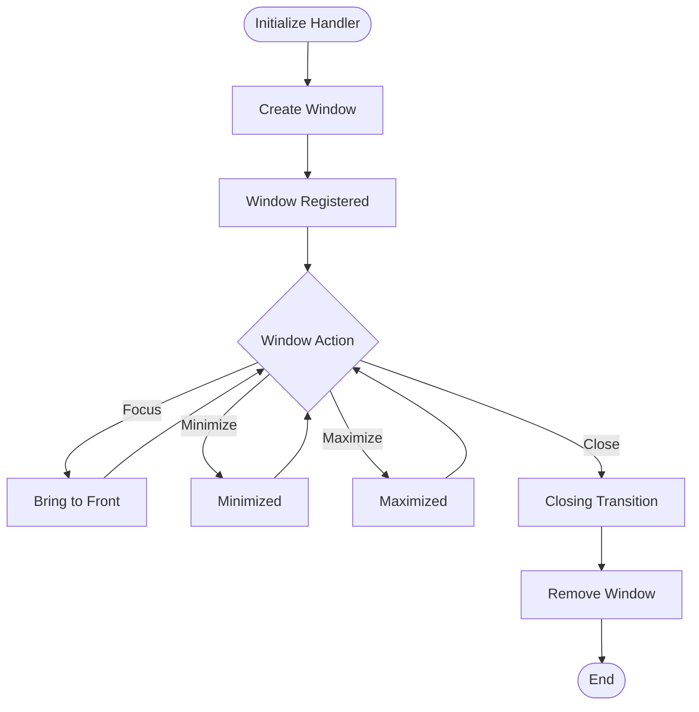
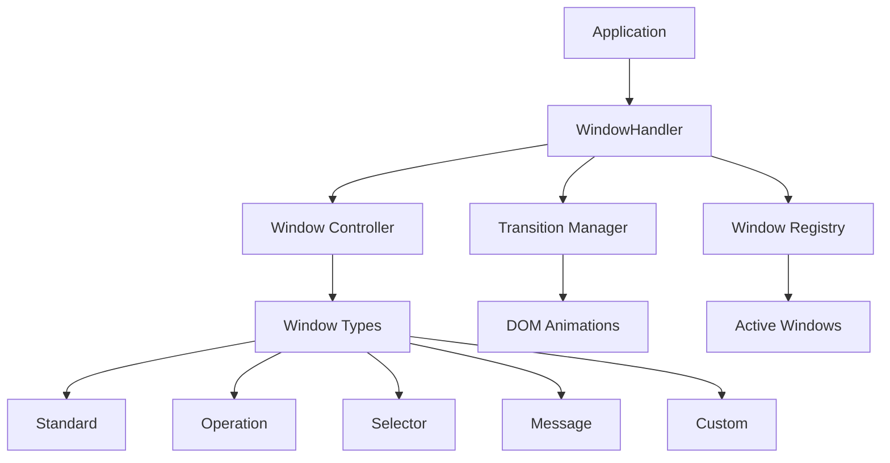

# Window Handler (winh)
> A lightweight JavaScript window management library for creating, controlling, and managing custom windows inside HTML DOM elements.
`go to the bottom`

[](LICENSE)
[](https://www.npmjs.com/package/winh)
[](https://www.npmjs.com/package/winh)

## Features
- Dynamic Windows — Create and remove windows dynamically using JavaScript.
- Window Management — Focus, minimize, maximize, restore, and close windows.
- Custom Window Types — Support for different window layouts and behaviors.
- Smooth Transitions — Animated window transitions with customizable durations.
- Lightweight — Minimal dependencies and a simple API.
- Extensible — Create custom window types and integrate your own HTML elements.

## Getting Started

### Prerequisites

- A modern web browser with JavaScript support.
- Node.js and npm (for package installation).
- Basic knowledge of HTML, CSS, and JavaScript.

## Installation

Install the package through npm in the terminal:
```bash
npm install winh
```

Alternatively, you can download or clone the repository and include the source files in your project.

## Usage

### 1. Initialize the Window Handler

Create a window handler by providing an HTML element that will contain your windows.

```js
import WindowHandler from "winh";

const handler = new WindowHandler(
    document.body
);
```

### 2. Create a Window

Use `createWindow()` to create a new window.

```js
const win = handler.createWindow({
    title: "My Window",
    type: "window"
});
```

### 3. Manage Windows

The handler provides methods for controlling window states.

```js
handler.minimizeWindow(win);
handler.maximizeWindow(win);
handler.restoreWindow(win);
handler.focusWindow(win);
handler.closeWindow(win);
```

### 4. Custom Window Types

Different window types can be used depending on the purpose of the window.

| Type | Description |
| --- | --- |
| "window" | Standard window with a titlebar and optional window controls.
"operation"| Compact operation window with a close control.
"selector"| Dropdown-style selection window with draggable positioning.
"message"| Simple message window with a close control.
"clear"| Minimal window without additional interface elements.
"custom"| Custom window generated through a JavaScript function.

Custom types allow you to extend the library and create interfaces suited to your application.

### 5. Window Lifecycle

A typical window follows this lifecycle:



### 6. Architecture

The library separates window management from individual window implementations.



### 7. Configuration

Window configuration is provided when creating a window.

| Property | Default | Description |
| --- | --- | --- |
"type"| "window"| Determines the window layout and behavior.
"title"| —| Sets the window title.
"width"| Type-dependent| Defines the window width.
"height"| Type-dependent| Defines the window height.

Additional configuration options may depend on the selected window type.

### 8. Transitions

Window transitions can be controlled through the transition manager.

```js
handler.transition(
    win,
    {
        left: "100px",
        top: "100px",
        width: "400px",
        height: "300px"
    },
    300
);
```

The transition duration is specified in milliseconds.

## Contributing

Contributions, suggestions, and improvements are welcome!

1. Fork the repository.

2. Create your feature branch:
```bash
git checkout -b feature/amazing-feature
```
3. Commit your changes: 
```bash
git commit -m "Add amazing feature"
```
4. Push your branch: 
```bash
git push origin feature/amazing-feature
``` 
5. Open a Pull Request.

## License

Distributed under the MIT License. See [license](LICENSE) for more information.

---

> Official first release coming soon.
> ~ CoconutCaty
